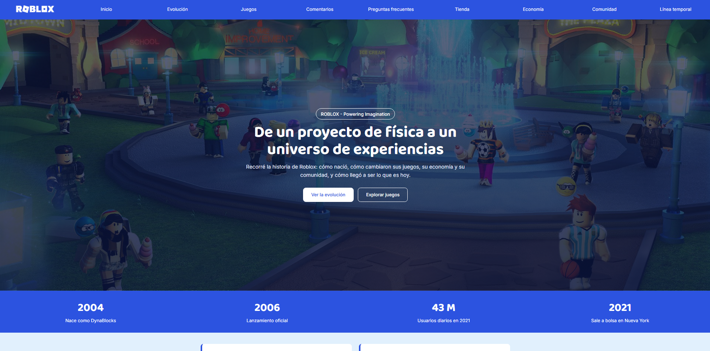

# Roblox: su evolución

Sitio web multipágina (HTML, CSS y JavaScript, sin librerías) que recorre la historia de Roblox: cómo nació, cómo cambiaron sus juegos, su economía y su comunidad. Incluye una tienda de ejemplo con carrito y un formulario de contacto con validación.

- **Autor:** José Mendoza
- **Idioma:** español (`lang="es"`)
- **Tipo de proyecto:** trabajo práctico integrador, sitio estático (no necesita servidor ni instalación)

  

## Cómo abrir el sitio

1. Descargue o copie la carpeta completa del proyecto (respetando las subcarpetas).
2. Abra `index.html` (ubicado en la raíz) con doble clic, o arrastrándolo al navegador.
3. Se navega con el menú superior, que lleva a las otras nueve páginas.

Opcional: con Visual Studio Code y la extensión *Live Server*, clic derecho sobre `index.html` → *Open with Live Server*.

> **Requiere internet** para mostrar las fuentes (Google Fonts) y los videos de youtube para las secciones de Inicio y Evolución.

## Estructura de carpetas

```
/
├── index.html                  ← página de inicio (siempre en la raíz)
├── README.md                   ← este archivo
├── HTML/
│   ├── evolucion.html
│   ├── lineatemp.html
│   ├── comunidad.html
│   ├── preguntas.html
│   ├── economia.html
│   ├── juegos.html
│   ├── testimonios.html
│   ├── tienda.html
│   └── contacto.html
├── CSS/                        ← una hoja de estilos por página
│   └── estilos_<pagina>.css
├── JS/                         ← solo las páginas con interactividad
│   ├── script_lineatemp.js
│   ├── script_preguntas.js
│   ├── script_testimonios.js
│   ├── script_tienda.js
│   └── script_contacto.js
└── Images/                     ← imágenes propias
```

Las páginas dentro de `HTML/` enlazan sus recursos con rutas como `../CSS/...`, `../JS/...` y `../Images/...`. `index.html` usa `./CSS/...`, `./HTML/...`, etc.

## Páginas

| Página | Archivo | Qué contiene | JavaScript |
|---|---|---|---|
| Inicio | `index.html` | Presentación del sitio y accesos a las secciones | — |
| Evolución | `HTML/evolucion.html` | Etapas de Roblox, con tabla índice | — |
| Línea temporal | `HTML/lineatemp.html` | Hitos de 2004 a 2026 | `script_lineatemp.js` |
| Comunidad | `HTML/comunidad.html` | Creadores, grupos y eventos | — |
| Preguntas frecuentes | `HTML/preguntas.html` | Preguntas desplegables | `script_preguntas.js` |
| Economía | `HTML/economia.html` | Robux, Tix y Player Points | — |
| Juegos | `HTML/juegos.html` | Juegos que marcaron historia | — |
| Testimonios | `HTML/testimonios.html` | Comentarios de la comunidad | `script_testimonios.js` |
| Tienda | `HTML/tienda.html` | Productos, filtros, detalle y carrito | `script_tienda.js` |
| Contacto | `HTML/contacto.html` | Formulario con validación | `script_contacto.js` |

## Cómo está hecho cada script

- **Línea temporal:** los hitos están en una lista (`hitos`); el script los dibuja, muestra el detalle del elegido y permite filtrar por tema y avanzar con *Anterior/Siguiente*.
- **Preguntas frecuentes:** al hacer clic en una pregunta se muestra u oculta su respuesta.
- **Testimonios:** las tarjetas se generan a partir de la lista `comentarios`.
  **Para agregar un comentario**, abra `JS/script_testimonios.js` y copie un objeto de la lista con estos campos: `nombre`, `edad`, `avatar` (`"mujer"` u `"hombre"`), `estrellas` (de 1 a 5) y `texto`.
- **Tienda:**
  - Los productos se generan desde la lista `productos` (**para agregar uno, se copia un objeto de esa lista** en `JS/script_tienda.js` con un `id` nuevo, sin repetir).
  - Permite filtrar por categoría, por rango de precio y ordenar de mayor a menor o al revés.
  - El botón *Comprar* abre una caja con el detalle (Confirmar / Cancelar).
  - El carrito se guarda en `localStorage` con la clave `carrito_tienda_roblox` (solo guarda los `id` de los productos), y permite eliminar productos o confirmar toda la compra.
  - La compra es **simulada**: se genera un ID de pedido (`PED-...`) pero no se cobra nada ni se envía a ningún servidor.
- **Contacto:** valida nombre, apellido, fecha, teléfono, email, descripción y archivo (JPG, PNG o PDF, hasta 5 MB). Muestra el error debajo de cada campo y lleva el foco al primero con error. Si todo está bien, muestra un mensaje de agradecimiento. **El envío es simulado**: no hay servidor. En `script_contacto.js`, la función `mostrarConfirmacion` indica dónde iría el envío real.

## Accesibilidad

- Enlace "saltar al contenido" al inicio de cada página.
- Foco visible al navegar con el teclado.
- Estructura semántica: `header`, `nav`, `main`, `section`, `article`, `footer`; un solo `h1` por página.
- Formularios con `label` asociado, mensajes de error con `aria-live`/`role="alert"` y campos marcados con `aria-invalid`.
- Las ventanas de la tienda (detalle y carrito) se cierran con `Esc` y devuelven el foco al botón que las abrió.
- Animaciones reducidas si el sistema tiene activada la opción *prefers-reduced-motion*.

## Diseño

- **Colores:** azul `#2c53e0` (principal), `#5175f7`, `#99afff`, `#1b3bb0` (oscuro), `#e8edff` (fondo claro) y dorado `#f5b301` / `#ffb703` (detalles).
- **Tipografías:** *Baloo 2* (títulos) e *Inter* (texto), desde Google Fonts.
- **Convención de nombres:** clases en `snake_case` (por ejemplo `.portada`, `.nav_logo`, `.campo_error`).
- **Responsive:** el menú se reacomoda por debajo de 900 px y el contenido pasa a una columna por debajo de 600 px.

## Imágenes
 
Toda imagen que se quiera usar en el sitio (logos, íconos, fotos, fondos) debe estar guardada dentro de la carpeta `Images/`, en la raíz del proyecto, y no enlazada desde otros sitios de internet.
 
Recomendaciones para agregar una imagen nueva:
 
- Nombre en minúsculas, sin espacios ni caracteres especiales y que describa su contenido (por ejemplo `blox-fruits.jpg`).
- Peso de menos de 200 KB (si pesa más, se puede comprimir o convertir a WebP).
- Texto alternativo (`alt`) que describa la imagen, sin usar palabras genéricas como "imagen" o "foto".
- Desde `index.html` se enlaza como `./Images/nombre.png` y desde las páginas dentro de `HTML/` como `../Images/nombre.png`.

## Créditos y derechos

Roblox y los nombres de sus juegos pertenecen a sus respectivos dueños. Este es un trabajo con fines educativos, sin relación oficial con Roblox Corporation. Las imágenes de terceros pertenecen a sus autores y fuentes originales.
